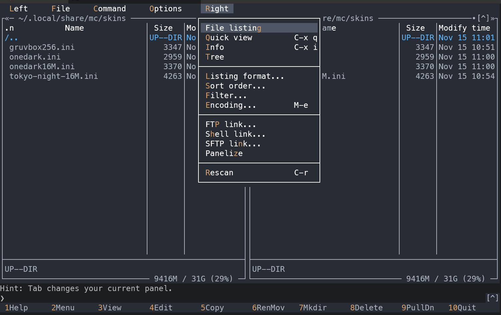

A Midnight Commander (`mc`) alapértelmezett skinje kék hátterű, és sötét témára állított terminálban, főleg esténként, alig olvasható. Ezért kezdtem el skineket használni.

## Milyen skinek vannak

A Debian 13 `mc` csomagja (4.8.33) 39 skint hoz a `/usr/share/mc/skins/` könyvtárban. Mindegyik kipróbálható az `mc -S <név>` kapcsolóval. Néhány típus:

- sötét háttérrel: `dark`, `nicedark`, `darkfar`
- 256 színesek, például `modarin256`, `xoria256`, `yadt256`, `julia256`
- truecolor (16M szín): a négy évszakos `seasons-*16M`

Az `mc` fejlesztői ágában már 41 skin van. A `tokyo-night-16M` és a `mashdark256` a Debian csomagban még nincs benne. A `mashdark256` fejléce szerint a [notnout/mashdark](https://github.com/notnout/mashdark) projektre épül (23 ★).

GitHubon további skinek is akadnak, de nem mind frissek (a csillagok 2026-11-15-i állapotot mutatnak):

- [Dornat/midnight-commander-gruvbox-skin](https://github.com/Dornat/midnight-commander-gruvbox-skin): gruvbox, 1 ★, 2020 óta nem változott
- [deadnews/mc-onedark](https://github.com/deadnews/mc-onedark): One Dark, 58 ★, MIT licenc, 2026 januárjában frissült
- [catppuccin/mc](https://github.com/catppuccin/mc): Catppuccin, 77 ★, 2022 óta nem változott
- [nkulikov/mc-solarized-skin](https://github.com/nkulikov/mc-solarized-skin): solarized, 30 ★, befejezetlen, 2012 óta nem változott
- [alexk7110/mc-electricblue256-skin](https://github.com/alexk7110/mc-electricblue256-skin): electricblue, 25 ★, 2018 óta nem változott
- [kybl/midnight-commander-skins](https://github.com/kybl/midnight-commander-skins): Norton, Volkov és Far skinek, 18 ★
- [MidnightCommander/skins](https://github.com/MidnightCommander/skins): skin szerkesztő, 42 ★

Ha csak a kék háttér zavar, a beépített `nicedark` vagy `dark` is megoldja (`mc -S nicedark`).

## Tokyo Night a fejlesztői ágból

A `tokyo-night-16M` 2026 májusában került az `mc` fejlesztői ágába. Egyetlen `.ini` fájl, ezért a Debian 13 `mc` 4.8.33 verziójához is letölthető, és be is töltődik:

```bash
mkdir -p ~/.local/share/mc/skins
curl -o ~/.local/share/mc/skins/tokyo-night-16M.ini \
  https://raw.githubusercontent.com/MidnightCommander/mc/master/misc/skins/tokyo-night-16M.ini
COLORTERM=truecolor mc -S tokyo-night-16M
```

A `16M` truecolort jelent, ehhez a terminálnak is támogatnia kell. A `COLORTERM=truecolor` változót is be kell állítani: nálam enélkül az `mc` nem használta a skin színeit, csak a terminál alapszíneit. A tartós beállításról a poszt végén írok.

## One Dark

A [deadnews/mc-onedark](https://github.com/deadnews/mc-onedark) két változatot ad. Az `onedark16M` truecolor, ezért független a terminál színsémájától. Az `onedark` csak 8/16 színt használ, vagyis a terminál saját palettáját veszi át, így hozzá One Dark színséma is kell a terminálba. Mindkettő egy-egy `.ini` fájl:

```bash
mkdir -p ~/.local/share/mc/skins
cd ~/.local/share/mc/skins
curl -O https://raw.githubusercontent.com/deadnews/mc-onedark/main/skins/onedark16M.ini
curl -O https://raw.githubusercontent.com/deadnews/mc-onedark/main/skins/onedark.ini
COLORTERM=truecolor mc -S onedark16M
```

A `COLORTERM=truecolor` itt is kell a 16M változathoz, a sima `onedark` nélküle is megy. A tartós beállításról a poszt végén írok.

Így néz ki az `onedark16M`:


{ width="1502" height="947" }

## gruvbox

A [gruvbox skin](https://github.com/Dornat/midnight-commander-gruvbox-skin) (MIT licenc) egyetlen `.ini` fájl, nem kell hozzá semmi más.

Letöltés:

```bash
mkdir -p ~/.local/share/mc/skins
curl -o ~/.local/share/mc/skins/gruvbox256.ini \
  https://raw.githubusercontent.com/Dornat/midnight-commander-gruvbox-skin/master/gruvbox256.ini
```

Kipróbálás:

```bash
mc -S gruvbox256
```

A skin 256 színes terminált igényel (pl. `TERM=xterm-256color`).

Több gépen Ansible-lel is kioszthatjuk: a homelab repo [`configure_mc-theme`](https://github.com/kecsi-san/homelab/tree/main/roles/configure_mc-theme) szerepköre pont ezt a letöltést végzi el.

## Alapértelmezett skin beállítása

Az `mc` a skint ebben a sorrendben keresi: `-S` kapcsoló, `MC_SKIN` környezeti változó, végül az ini fájl `skin` kulcsa. Alapértelmezettnek tehát a legegyszerűbb az ini fájlba írni (vagy az `Options → Appearance → Skin` menüből kiválasztani):

```ini
# ~/.config/mc/ini
[Midnight-Commander]
skin=onedark16M
```

A truecolor skinekhez (`onedark16M`, `tokyo-night-16M`) ez még nem elég: az `mc` csak akkor használ 24 bites színeket, ha a `COLORTERM` változó értéke `truecolor` vagy `24bit`. Kipróbáltam, a `COLORTERM=1` és a `TERM=xterm-direct` nem jó. Enélkül a skin betöltődik, de az `mc` a terminál alapszíneit használja. Először nézd meg, mit ad az `echo $COLORTERM`. Ha üres, a `~/.bashrc` fájlba (vagy a `~/.profile` fájlba, ha a terminálod login shellt indít) ezt kell írni:

```bash
export COLORTERM=truecolor
```

Ezt csak olyan terminálban állítsd be, amelyik tud truecolort. A 256 színes skineknél (például `gruvbox256`) nem kell.

SSH-n át a változó átmehet a távoli gépre is, ha a kliens küldi (`SendEnv COLORTERM`), a szerver pedig elfogadja (`AcceptEnv COLORTERM`). Nálam a Debian 13 kliens `/etc/ssh/ssh_config` fájlja és az egyik szerver `sshd_config` fájlja is így van beállítva, ezért elég a helyi gépen megadni. Máshol vagy a két beállítást kell felvenni, vagy a távoli gép `~/.bashrc` fájljába is be kell írni a fenti sort.
